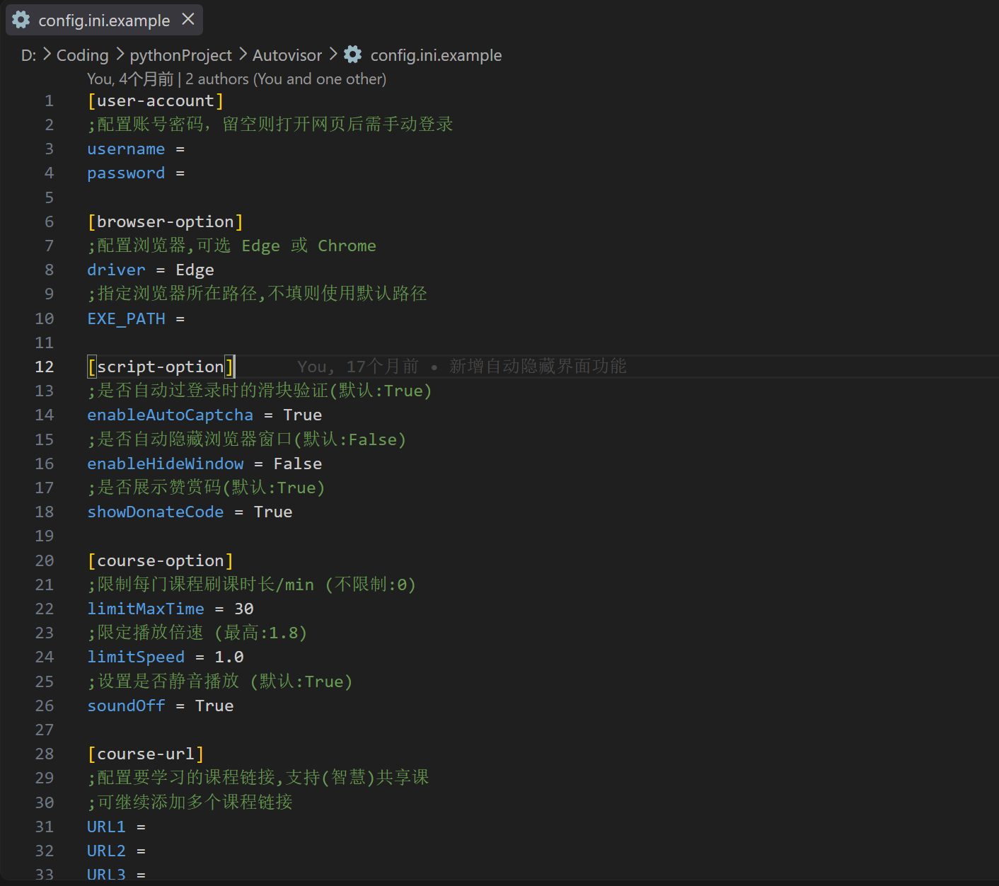
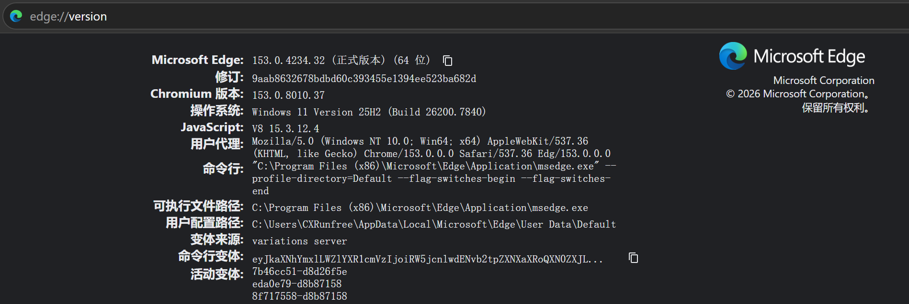

# Autovisor（智慧树刷课）

自动播放智慧树课程视频、切换下一集、处理课中弹题。基于 Playwright，用浏览器模拟用户操作。

fork 自 [CXRunfree/Autovisor](https://github.com/CXRunfree/Autovisor)，这个分支（`feat/low-fingerprint-cross-platform`）做了三件事：

- **降低自动化特征**：不注入任何脚本，点击、滚动、输入都是浏览器生成的真实输入，倍速和静音改为点播放器自己的控件（详见技术细节里的[降低自动化特征](#降低自动化特征)）。
- **跨平台**：Linux、macOS 可以源码运行，三平台 CI。
- **只读诊断命令**：适配新版页面时先看真实结构，不产生学习记录。

> 上游的 Windows 发行版（`Autovisor.exe`）是上游打包的，**不包含本分支的改动**。想用本分支，请按下面的教程源码运行。

## 一、初级使用教程

### 1. 准备（只做一次）

- **浏览器**：Windows 默认用 Edge，Linux / macOS 默认用 Google Chrome。
- **下载这个仓库**：在 GitHub 页面点 **Code → Download ZIP** 解压；或者 `git clone https://github.com/lmmmp-17/Autovisor.git`。
- **不需要自己装 Python**。入口脚本会用 [uv](https://docs.astral.sh/uv/) 准备好 Python 3.13 和全部依赖；没有 uv 的话：Linux / macOS 会自动装；Windows 上先从清华的 PyPI 镜像下载 uv，不行再用 winget，双击 run.cmd 时会先问你，从网课助手启动时直接装（那里没法回答问题）。Windows 上 Python 和依赖默认也从国内镜像下载（清华 PyPI、npmmirror），装不上再用官方源试一次。

### 2. 运行

| 系统 | 怎么启动 |
| --- | --- |
| Windows | 双击仓库里的 **`run.cmd`** |
| Linux / macOS | 在仓库目录下执行 **`./run.sh`** |

接下来：

1. 第一次运行会从模板生成配置文件（Windows 是 `config.ini`，Linux 是 `config.linux.ini`，macOS 是 `config.macos.ini`），再自动准备环境：uv、Python 3.13、依赖，要等一会儿。之后改了配置或依赖也会自动更新。
2. 程序会打开浏览器，在里面**登录智慧树**（登录页的滑块自己拖）。登录状态会存下来，下次不用再登。
3. 在浏览器里**点开要刷的课程**，进到能看到视频的播放页。程序认出来就会自动开始。

按 `Ctrl+C` 停止（Windows 上命令行接着会问 `Terminate batch job (Y/N)?`，即「终止批处理操作吗」：按 Y 直接关窗口，按 N 留着窗口看结束时的总结）。配置不用改就能跑：默认静音、切到播放器允许的最高倍速、每门课最多跑 30 分钟。

### 3. 它会做什么

- 自动播放、放完切到下一集；暂停了会自动续播。
- 先静音，再切到播放器允许的最高倍速（这个播放器最高 1.5x）。
- 课中弹题（不计分）自动作答并关掉；其它弹窗自动跳过。
- 没有视频的课时（计分测验、PPT、PDF 等）**自动跳过**，课程结束时列出跳过了哪些。这些需要你自己完成，本工具不代做计分的测验。
- 支持智慧共享课、翻转课、融合共享课，也能刷习惯分。认得出来的课程页在这几个域名下：`studyvideoh5`、`studywisdomh5`、`fusioncourseh5`、`wisdom-mooc`（融合共享课，只认 `/study` 开头的页面）、`hike`，后面都是 `.zhihuishu.com`。

## 二、注意事项

### 运行期间

- 浏览器窗口可以被别的窗口**盖住**，或者挪到另一个桌面，失焦不会打断播放。**不要最小化**，最小化后页面会变成后台状态，视频直接停，弹题也检测不到。
- 程序运行时，别在那个浏览器窗口里动鼠标。
- 长时间挂机可能弹出人机验证，程序检测到后会暂停，等你手动完成。
- 命令行窗口是程序的后台，可以看运行状态；浏览器打开需要一点时间，命令行没报错退出就不用担心。

### 遇到问题

| 现象 | 处理 |
| --- | --- |
| `配置文件无效` | 配置文件被改坏了。删掉它重新运行一次入口脚本，会重新生成。配置项不要加引号 |
| 点开课程后一直没开始 | 要进到能直接看到视频的**播放页**，课程首页、课程列表不算；再看一眼地址栏的域名是不是上面列的那几个 |
| `浏览器启动失败` | 看配置里的 `driver` 是不是你装了的浏览器（`Edge` 或 `Chrome`）；装在非默认位置的，见进阶教程里的配置项 |
| 登录时要手动拖滑块 | 默认就是这样。想自动过，见进阶教程里的 `enableAutoCaptcha` |
| 卡在加载 / 不跳下一课 / 新版 AI 课刷不了 | 页面结构还没适配，不是配置问题。带 AI 角标的新版课程目前没适配。附上课程链接和命令行输出提 issue |
| 弹题关不掉 / 程序卡住 | 弹题随时可能出现，检测不是实时的。先确认浏览器没有被最小化 |

## 三、进阶教程

### 配置项

| 配置项 | 默认 | 说明 |
| --- | --- | --- |
| `URL1`、`URL2`… | 空 | 课程播放页的地址（能直接看到视频的那一页）。填了就不用自己点，按顺序一门一门跑完；全部留空就是运行后在浏览器里自己点开一门课。命令行加 `--wait-course` 可以临时不用这里的地址 |
| `username` / `password` | 空 | 留空就在打开的浏览器里手动登录。登录状态会存到 `data/cookies.json`，下次不用再登 |
| `soundOff` | `True` | 静音。启动的浏览器整个不出声，播放器上也会点静音 |
| `limitSpeed` | `max` | 切到播放器倍速菜单里最高的一档。也可填具体数字（取不超过它的最高档），`0` 则完全不碰。这个播放器只有 1.0 / 1.25 / 1.5 三档 |
| `limitMaxTime` | `30` | 每门课最多跑多少分钟，`0` 不限 |
| `driver` | Windows 为 `Edge`，Linux / macOS 为 `Chrome` | 用哪个浏览器。Linux 上也可以填 `Chromium`，会自动下载 |
| `EXE_PATH` | 空 | 浏览器装在非默认位置时填它的完整路径。找路径：在浏览器地址栏打开 `chrome://version`（Edge 是 `edge://version`），看"可执行文件路径" |
| `enableAutoCaptcha` | Windows 模板为 `True`，Linux / macOS 为 `False` | 自动过登录滑块，要填了账号密码才用得上。开着时会多装 numpy、opencv |
| `enableHideWindow` | `False` | 把窗口移出屏幕，看不见但照常播放，只在 Windows 上有效。想后台刷课用它，别最小化；报 `MoveWindow 无效的窗口句柄` 就改回 `False` |
| `attachExistingChrome` | `False` | 连接你已经开着的 Chrome，见下一节 |

Linux / macOS 可以用 `./run.sh --setup` 强制重建环境。Linux 用 `Chromium` 报缺少系统库时，执行 `sudo uv run playwright install-deps chromium`。

### 连接你已经开着的 Chrome

特征最低的方式：用的是你自己的浏览器和登录状态，没有任何启动参数痕迹。

1. 用调试端口启动一个 Chrome（单独的 profile 目录，和平时用的分开）：

   ```bash
   # Linux
   google-chrome --remote-debugging-port=9224 --user-data-dir="$HOME/autovisor-chrome" --disable-backgrounding-occluded-windows --mute-audio &

   # macOS
   "/Applications/Google Chrome.app/Contents/MacOS/Google Chrome" \
     --remote-debugging-port=9224 --user-data-dir="$HOME/autovisor-chrome" --disable-backgrounding-occluded-windows --mute-audio &
   ```

   ```bat
   :: Windows（cmd）
   "%ProgramFiles%\Google\Chrome\Application\chrome.exe" --remote-debugging-port=9224 --user-data-dir="%USERPROFILE%\autovisor-chrome" --disable-backgrounding-occluded-windows --mute-audio
   ```

   - 一定要加 `--mute-audio`：这个模式下程序管不到浏览器的启动参数，`soundOff` 只能去点播放器的静音按钮，视频刚开始的一两秒可能会有声音。
   - `--disable-backgrounding-occluded-windows` 也别漏：Windows 上不带它，窗口被别的窗口完全盖住不到 1 秒视频就停了。

2. 在这个 Chrome 里登录智慧树。
3. 配置里改成 `attachExistingChrome = True`（`cdpUrl` 默认就是 `http://127.0.0.1:9224`）。端口特意和学习通（9222）、雨课堂（9223）错开，三个工具可以同时跑。
4. 照初级教程的「运行」一节启动。

这个模式下程序不会把 Cookie 写进 `data/cookies.json`，结束时只关闭自己打开的标签页，也不会隐藏你的窗口。用完把这个 Chrome 关掉：调试端口开着时，本机的任何程序都能控制它。

### 只读诊断命令

页面改版、刷不了的时候用。都会拦掉进度上报，不产生学习记录。Windows 上在命令行里把 `./run.sh` 换成 `.\run.cmd`，前面的 `.\` 不能省：

```bash
./run.sh --check-browser                        # 浏览器能不能启动、有没有登录
./run.sh --check-course  <课程播放页地址>        # 课程目录能不能识别
./run.sh --check-player  <课程播放页地址>        # 播放器控件结构（不播放）
./run.sh --check-quiz    <课程播放页地址> [--seek 秒数]   # 课中弹题结构（静音播放等弹题，不作答）
```

### 上游的 Windows 发行版

上游提供打包好的 `Autovisor.exe`，解压即用，但**不包含本分支的改动**。下面是上游的说明，原样保留。

#### 发行版运行

1. 请确保系统为 Windows 10 及以上.

2. 发行版文件夹内自带 **config.ini** (可能没显示 `.ini` 后缀名), 使用 **文本编辑器** 打开.

3. 根据文件内的注释, 填写配置文件:

   - 默认启动系统自带的 Edge 浏览器;
   - 文件里的 **EXE_PATH 项** 用于自定义浏览器路径, 需要精确到**浏览器可执行文件的位置**, 可以保持默认不填;
   - 不知道浏览器的安装路径? 见下方 **常见问题**.
   - 确认 **保存修改** 后再退出.

   <p align="left"></p>

4. 注意事项

   - **`config.ini` 配置项不需要加引号.**

   - **如果需要修改下载镜像源, 请编辑 `data/mirrors.json`**

5. 运行 **Autovisor.exe**, 会自动打开浏览器, 进入网课界面后就能自动刷课了!

   (如果未设置 **enableAutoCaptcha=True**, 则需要**手动完成**登录时的滑块验证)

**发行版目录说明:**

- `resources/`: 图片、脚本等程序资源.
- `packages/`: 自动下载的 NumPy、OpenCV 等运行时依赖.
- `data/`: 登录 Cookies 和镜像源配置.

#### 发行版下载

- Github: [Releases · CXRunfree/Autovisor](https://github.com/CXRunfree/Autovisor/releases)
- 网盘备用: [蓝奏云 · Autovisor-for-windows](https://wwk.lanzouj.com/b05evsxif) 密码: 492l

这是已经打包好的程序, 若需要**源代码**请于 Github 项目主页下载.

#### 发行版常见问题

1. 解压后没有 `Autovisor.exe` / 提示缺少依赖文件?

   - 多为杀毒软件误杀: 加入信任区后重新解压; 也请确认下载的是 Releases 里的发行包, 而不是源码.

2. 第一次启动很久没反应 / 依赖下载失败?

   - 首次会检查并下载运行时依赖 (numpy、opencv-python), 等后台日志跑完即可; 下载失败会自动换用 `data/mirrors.json` 里的下一个镜像.
   - 报 `ModuleNotFoundError` / `ImportError: numpy...` 时, 删掉 `packages/` 目录重新运行.

3. 只出现命令行窗口, 没有浏览器界面?

   - 报错通常是浏览器路径配置有误. 找浏览器路径: 打开浏览器, 地址栏输入 `chrome://version`, 其中的"可执行文件目录"就是.

   <p align="left"></p>

#### 上游更新记录

**本次更新:**

- 新增融合共享支持: 自动跳过弹窗、展开折叠目录、关闭弹窗后恢复播放, 并读取课时真实进度 ([#158](https://github.com/CXRunfree/Autovisor/pull/158)).

**近期更新:**

- 修复课程页卡死: 已读的"学前必读"弹窗是隐藏节点, 等它可见会一直等下去, 现在超时即跳过 ([#155](https://github.com/CXRunfree/Autovisor/pull/155)).
- 课时切换、目录识别的等待也加上超时, 异常页面不再长时间卡住.
- 支持 Python 3.13.

## 四、有价值的技术细节

### 为什么可以被盖住、但不能最小化

- 失焦靠焦点模拟兜住，但 `document.visibilityState` 没有办法模拟：最小化后页面变成 `hidden`，视频随之暂停，弹题检测也跟着停。
- Windows 上还多一种情况：浏览器会追踪窗口有没有被盖住。实测（Chrome 155 / Win11）窗口被别的窗口完全盖住后 1 秒内页面就变 `hidden`，视频被直接暂停。启动参数 `--disable-backgrounding-occluded-windows` 能让它被盖住时保持 `visible`，但兜不住最小化。
- 普通模式由 Playwright 启动浏览器，它默认就带这一项（`tests/test_browser.py` 里有测试防止它被去掉）；连接已有 Chrome 时程序管不到启动参数，所以要在手动命令里自己带。

### 第一次运行要下载的东西，从哪儿下

用这个工具的人大多在国内，GitHub、PyPI 从很多网络上很慢或者连不上，所以准备环境时会用国内镜像。镜像都装不上时，会退回官方源再试一次。

| 要下载的 | 官方来源 | 国内镜像 |
| --- | --- | --- |
| uv 本身 | GitHub（winget、官方安装脚本都从这里下） | 清华 / 阿里的 PyPI 镜像。uv 在 PyPI 上发布的 wheel 里带着 uv 可执行文件，取出来放进 `~/.local/bin`，和官方安装脚本装的位置一样 |
| Python | uv 的 Python 构建（python-build-standalone） | npmmirror（`UV_PYTHON_INSTALL_MIRROR`） |
| 依赖包 | PyPI | 清华 PyPI（`UV_DEFAULT_INDEX`） |

- **Windows（run.cmd）**：默认先走镜像，镜像失败再走官方源。用的都是解压出来的压缩包，uv 把 `uv.lock` 里的下载地址改写成镜像的也不碍事；包的版本不变，实测过。uv 本身由 `resources/install-uv.ps1` 从 PyPI 镜像安装，不行再用 winget。
- **Linux / macOS（run.sh）**：先走官方源，失败了再走镜像。这边多半是 git 克隆下来的，默认走镜像的话，`uv.lock` 会被改写，git 工作区就脏了。一旦用过镜像，后面也一直用镜像，不然 `uv run` 会把 `uv.lock` 改回去。
- 你自己设过 `UV_DEFAULT_INDEX` 或 `UV_PYTHON_INSTALL_MIRROR` 的话，以你的设置为准，不会自动换。
- `driver = chromium` 时，Playwright 自带的 Chromium 仍然从官方 CDN 下载，没有走镜像。默认用系统里装的 Chrome / Edge，不需要这一步。

### 降低自动化特征

适配新版页面时先跑[只读诊断命令](#只读诊断命令)。被弹题或安全验证的弹窗挡住时, 播放器调节会跳过这一轮再等, 不去硬点被遮住的控件 (否则必然失败并退回写属性).

以下每一项都在真实浏览器里实测过 (`tests/test_e2e_browser.py`):

| 页面能读到的 | 改动前 | 现在 |
| --- | --- | --- |
| `navigator.webdriver` | `undefined` (stealth 把属性删了) | 原生的 `false` |
| `'webdriver' in navigator` | `false` | `true` |
| `navigator.languages` 等 getter | 被替换, 不是原生函数 | 原生 |
| WebGL 显卡信息 | 写死成 Mac 的 `Intel Iris OpenGL Engine` | 本机真实显卡 |
| `screen` / 视口 | 固定模拟成 1280x720, 会出现视口比窗口还大 | 跟随真实屏幕与窗口 |
| 点击事件 `isTrusted` | 弹窗、协议勾选、融合课弹窗等处为 `false` | 全部为 `true` |
| 点击轨迹 | 一步瞬移到元素正中心, 按下抬起 0 间隔 | 贝塞尔曲线移动, 落点靠中心但有偏差, 按住几十毫秒 |
| 目录滚动 | 协议级滚动, 只有 scroll 没有 wheel | 真实滚轮 |
| 账号密码 | `fill()` 一次写入, 没有按键事件 | 逐字输入 |
| 页面标题 (Windows 隐藏窗口时) | 被改成 `Autovisor - Playwright` | 不改; 仅在标题匹配不唯一时临时换随机串并立即改回 |
| 轮询节拍 | 每 2 秒 / 0.5 秒整 | 以基准值为中心抖动 |
| 停顿的分布形状 | 区间内均匀取值, 变异系数 0.17~0.28 | 对数正态(多数偏短、偶尔拖久), 变异系数约 0.46 —— 本地靶场实测真人是 0.45~0.49 |
| 弹题的读题时间 | 与题目内容无关的固定区间 2.5~7 秒 | 按题干字数估算(约 4.5~9 字/秒)。实测真人的「用时 ~ 题干长度」相关系数 +0.81~+0.99, 固定区间则围绕 0 波动 |
| 倍速 | 写 `video.playbackRate`, 再改写播放器的倍速标签文字 | 点播放器的倍速菜单, 标签由它自己更新; 默认切到菜单里最高的一档 |
| 静音 | 写 `video.volume = 0`, 再给 `.volumeBox` 加 `volumeNone` 伪造图标 | 点播放器的音量按钮, 图标由它自己切换 |
| 起播 / 暂停后恢复 | 调 `video.play()` | 点视频区域 |
| 课中弹题 | 每题固定点"前两个"选项(单选题答案永远落在第二个)、选项间隔 100ms、1 秒多就答完关掉 | 按题型随机选(单选一个/多选多个但不全选)、先有读题停顿、点击带轨迹 |
| 关闭弹题 | `page.press(".el-dialog", "Escape")` —— 页面上有 12 个 `.el-dialog`, 命中的是第一个隐藏的"温馨提示", 一直超时 | 点弹题弹窗自己的"关闭"按钮 |

做法:

- 不再注入 `stealth.min.js`. 在有界面的新版浏览器里它弊大于利 (见上表前四行), 改为启动时去掉 `--enable-automation` 并关闭 `AutomationControlled`.
- 页面里的 `el.click()` 全部换成真实输入. 页面脚本派发的事件 `isTrusted` 恒为 `false`, 而且这个属性改不掉.
- 启动后用 CDP 保持页面"前台、活跃": 不进入冻结状态, 空闲检测恒为活跃 (焦点模拟由 Playwright 默认开启).
- 任何一步真实点击走不通 (元素被遮挡、拿不到尺寸), 都会退回 Playwright 原生点击, 不会比原来更容易卡住.

倍速 / 静音 / 起播已经改成点播放器自己的控件 (`modules/player.py`). 控件结构是用 `--check-player` 在真实页面上取到的:

```
.videoArea                      指针移上去控制栏才展开, 平时收起
.volumeBox > .volumeIcon        静音开关
.speedBox  > span               当前倍速标签, 文字形如 "X 1.0"
.speedBox  > .speedList
    .speedTab 'X 1.5' / 'X 1.25' / 'X 1.0'
```

两个实测出来的坑:

- 控制栏默认收起, 而且是靠祖先的 `pointer-events: none` 挡住的——光看元素尺寸看不出来 (`locator.hover()` 会超时). 必须先把指针移到视频区域, 再移到具体控件, 并且落点之后要补一次极小的移动迫使浏览器重新做命中测试; 少了这一步, 倍速菜单会间歇性打不开.
- `.speedTab` 的类名后缀和倍速值对不上 (`speedTab10` 的文字是 `X 1.5` 以外的 `X 1.25`), 所以按标签文字里的数字匹配, 不按类名.

这个播放器只提供 1.0 / 1.25 / 1.5 三档. 模板里的默认值是 `limitSpeed = max`, 也就是切到菜单里最高的那一档; 填具体数字则取不超过它的最高一档, 填 `0` 完全不碰倍速.

**只用菜单里列出来的档位**, 不再退回写 `playbackRate`: 菜单里没有的值只能靠写属性再伪造倍速标签的文字, 页面一眼就能看出来, 而且那本来也不是平台允许的档位. 所以 `limitSpeed = 1.8` 现在的结果是 1.5, 不是 1.8.

同一个视频只调一次倍速: 记下 (视频地址, 倍速), 处理过就不再碰, 换了视频或者播放器把倍速改回去了才重新调. 以前的判断是 "当前倍速 < 上限", 而 `max` 的上限是无穷大, 这个条件永远成立: 已经在 1.5 了, 每一轮 (约 2 秒) 还会把指针移到控制栏、打开菜单再点一次 1.5, 看上去就是在无限选倍速 (Windows 上实测). 已经在目标档位时也不再点. 菜单走不通(页面刚打开时控制栏常常还点不动)不放弃, 隔 4、8、16、32 秒再试, 之后每分钟一次, 免得指针一直在控制栏上晃. 曾经是试 3 次就不管, 结果刚打开那十几秒正好失败 3 次, 整个视频停在 1 倍速.

每一步真实控件操作走不通时都会退回原来的属性写入, 并在日志的"播放器调节 / 恢复播放"事件里写明用的是哪种方式 (`点菜单` / `写属性`, `点视频区域` / `脚本调用`), 所以退化是看得见的.

课中弹题 (`modules/quiz.py`) 改动前是:

```python
for each in choices[:2]:            # 固定点前两个选项
    await each.click(timeout=500)
    await page.wait_for_timeout(100)
...
await page.press(".el-dialog", "Escape", timeout=1000)
```

问题不在于乱选 (弹窗自己写着"不会影响到大家作业和考试的成绩"), 而在于选得太有规律: 单选题点第一个再点第二个, 答案永远落在第二个选项上, 还产生两次选择事件; 真实日志里弹题出现到关闭只隔 1.6 秒, 没有任何读题时间.

真实弹题的结构 (`--check-quiz` 实测):

```
div#playTopic-dialog.el-dialog__wrapper.dialog-test    弹题弹窗, 有唯一 id
  div.el-dialog__header > button.el-dialog__headerbtn   关闭 ×
  div.el-dialog__footer > span.dialog-footer > div.btn  "关闭"按钮(不是 el-button)
.el-scrollbar__view > div.topic                        一道题一个 .topic
  div.el-pagination > ul.el-pager > li.number          题号其实是分页器页码
  div.radio
    p.topic-title > span.title-tit '【多选题】'          题型写在这里
    ul.topic-list > li.topic-item                      选项
    p.answer '正确答案：A,B,C'                           答过之后才出现, 在 .topic 内
```

据此改掉的两个真 bug:

- **关闭弹窗一直是失败的.** 页面上同时有 12 个 `.el-dialog` (AI 助教、异常提示等, 大多隐藏), `page.press(".el-dialog", ...)` 命中的是第一个隐藏的"温馨提示", 所以一直超时 —— 日志里那条 `答题模块轮询未命中(元素 .el-scrollbar__view/.el-dialog): TimeoutError` 就是它. 现在点弹题弹窗自己的"关闭"按钮.
- **`.answer` 的判断扫的是全页**, 别的隐藏弹窗里也有 `.answer`. 现在收窄到当前 `.topic` 内.

作答改成: 读 `.title-tit` 判断题型, 单选选一个、多选选两个以上但不全选 (全选会变成新的固定模式), 带读题停顿, 点击走指针轨迹, 约 18% 概率改一次主意. 依旧不尝试答对.

还没处理的:

- 进度回退 (`course_playback.py` 里播放器快于平台记录时的对齐) 仍是设置 `currentTime`.
- 几个提示浮层 (`.exploreTip` 等) 仍是直接从页面里删掉.
- 题号是 Element UI 分页器, 题目很多时分页器会把页码折叠成 `...`, 这时 `li.number` 的数量不等于总题数. 实测遇到的弹题都只有 1 道, 多题情况没验证过.

**连接已有 Chrome (`attachExistingChrome = True`)** 这个开关在 3.18.x 里只对 `--check-browser` 生效, 正式运行时被忽略 (合并 #149 时丢失), 现已恢复. 用法见[连接你已经开着的 Chrome](#连接你已经开着的-chrome).

### 目录结构

```
Autovisor/
├── README.md
├── run.cmd                   入口（Windows）：双击运行；第一次生成配置，之后自动准备环境并运行
├── run.sh                    入口（Linux / macOS）：同上
├── run_macos.sh              旧入口，等同于 run.sh
├── Autovisor.py              程序主体：读配置、开浏览器、登录、逐门课播放；--check-* 诊断也从这里进
├── config.ini.example        配置模板：Windows
├── config.linux.ini.example  配置模板：Linux
├── config.macos.ini.example  配置模板：macOS
├── pyproject.toml, uv.lock, .python-version   依赖与 Python 版本
├── modules/                  程序本体，见下表
├── tests/                    单元测试；test_e2e_browser.py 用真实浏览器跑
├── data/                     运行时数据：镜像源配置 mirrors.json、登录状态 cookies.json
├── resources/                图标、README 用的图片
├── build.py                  打包 Windows 发行版（PyInstaller）
├── packages/                 Windows 发行版的运行时依赖（DLL；numpy、opencv 也会下载到这里）
└── .github/workflows/        CI：三平台单元测试 + Linux / macOS 启动脚本
```

上游的图形界面 `GUI.py` 已删除，改由统一启动器（launcher）提供。

`modules/` 按职责分：

| 分组 | 文件 | 作用 |
| --- | --- | --- |
| 课程流程 | `course_runner.py` | 一门课的主循环：识别目录、逐个课时播放、到时限结束 |
| | `course_playback.py` | 单个课时：播放到完成、回看 |
| | `lesson_navigation.py` | 课程目录：各类课程的目录选择器、课时进度与完成判断 |
| | `fusion_adapter.py` | 融合共享课：跳过弹窗、展开折叠目录 |
| | `progress.py` | 课程进度的读取与显示 |
| 播放器与弹题 | `tasks.py` | 播放期间的后台任务：起播与续播、静音和倍速、弹窗遮挡检测 |
| | `player.py` | 点播放器自己的控件：倍速菜单、静音按钮、视频区域 |
| | `quiz.py` | 课中弹题：按题型作答，点"关闭" |
| | `video_state.py` | 视频时间相关的判断 |
| 浏览器与输入 | `browser.py` | 启动 / 连接浏览器，启动参数 |
| | `pointer.py` | 真实指针：贝塞尔轨迹、点击、滚轮 |
| | `human.py` | 随机化：等待时长抖动 |
| | `login.py` | 登录：逐字输入账号密码、勾选协议 |
| | `slider.py` | 登录滑块自动验证（可选） |
| 诊断 | `diagnostics.py` | `--check-browser` / `--check-course` / `--check-player` / `--check-quiz` |
| 程序支撑 | `configs.py` | 读配置文件 |
| | `logger.py`、`console.py`、`banner.py` | 日志与终端输出 |
| | `utils.py` | Cookie 读写、运行目录、窗口操作等杂项 |
| | `installer.py` | 发行版运行时依赖的下载与校验 |
| | `updater.py`、`version.py` | 检查更新、版本号 |

### 测试

```bash
uv run python -m unittest discover -s tests                         # 单元测试
AUTOVISOR_E2E=1 uv run python -m unittest tests.test_e2e_browser -v  # 真实浏览器（会弹出窗口，期间别碰键盘）
```

`run.cmd` 在 Windows 11 上实测跑通过：生成配置、用记事本打开、`uv sync --extra captcha` 装好 Python 3.13 和依赖、用改过的参数拉起 Edge。

---

**声明：本程序只可用于学习和研究计算机原理, 请于 24h 内删除所有存档！**
